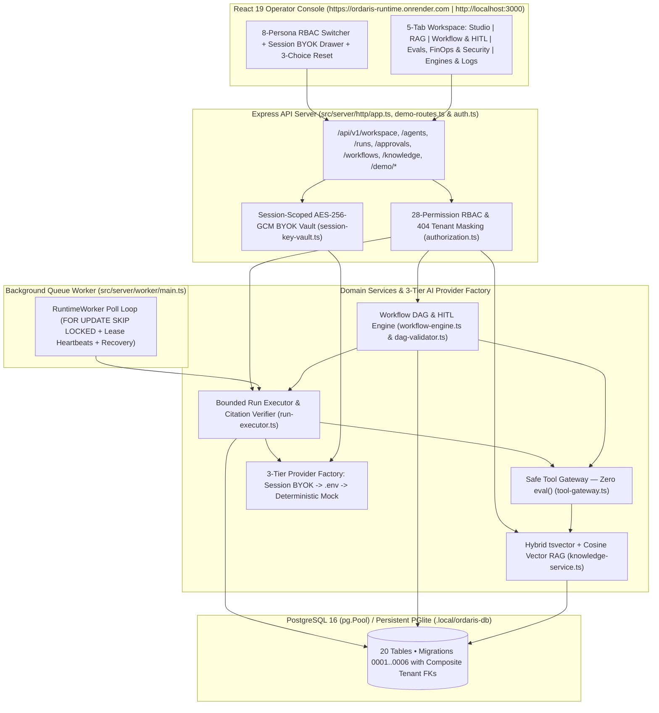

# Ordaris Runtime (`v1.0.0-demo`) — Enterprise Governed AI Agent, Hybrid RAG & Workflow Runtime

> ### 🌐 Live Hosted Deployment (Render Cloud Sandbox)
> - **Interactive Operator Console (8-Persona Multi-Tenant Sandbox)**: **[https://ordaris-runtime.onrender.com](https://ordaris-runtime.onrender.com)**
> - **Live Process Health Probe (`200 OK`)**: [`https://ordaris-runtime.onrender.com/api/v1/health/live`](https://ordaris-runtime.onrender.com/api/v1/health/live)
> - **Database Readiness Probe (`SELECT 1`)**: [`https://ordaris-runtime.onrender.com/api/v1/health/ready`](https://ordaris-runtime.onrender.com/api/v1/health/ready)
> - **1-Click Deploy Your Own Instance on Render**: [](https://dashboard.render.com/select-repo?type=blueprint) *(Blueprint Name: `ordaris-runtime-platform` • Service Name: `ordaris-runtime`)*

---

**Ordaris Runtime** is a local-first and cloud-ready, defense-in-depth multi-tenant AI agent orchestration, Hybrid Retrieval-Augmented Generation (RAG), Directed Acyclic Workflow (DAG), Human-in-the-Loop (HITL) governance, FinOps telemetry, and automated evaluation platform backed by an Express HTTP API, a durable PostgreSQL job worker (`FOR UPDATE SKIP LOCKED`), and Drizzle ORM.

Built under a strict **Zero-Required-Spend (`ADR-001`)** and **Defense-in-Depth Tenant Isolation (`ADR-002`)** architecture, the entire full-stack application runs deterministically out of the box with zero external API keys required (`AI_MODE=demo`), while allowing operators and technical evaluators to plug in free-tier cloud AI keys (`Gemini`, `ChatGPT`, `Claude`, `Grok`, `OpenRouter`) at runtime via a **Session-Scoped AES-256-GCM BYOK Vault** or `.env` configuration.

---

## 1. Core Architectural Pillars (`v1.0.0-demo`)

1. **8-Persona Multi-Tenant RBAC & Composite PostgreSQL Foreign Keys (`TENANT-001`..`004`, `ADR-002`)**
   - Pre-seeds **2 isolated organizations** (`Acme Cyber Defense` and `Beta Global Logistics`) and **8 distinct personas** (`owner`, `admin`, `developer`, `viewer` per tenant).
   - Composite `(organization_id, ...)` foreign keys across `agent_versions`, `runs`, `run_steps`, `run_events`, `job_queue`, `document_chunks`, `workflow_versions`, `approval_requests`, `usage_events`, and `eval_experiments` prevent cross-tenant parent-child references at the database constraint layer.
   - Central policy engine (`src/server/policies/authorization.ts`) enforces a **28-permission RBAC matrix**, masks cross-tenant resource lookups with `404 Not Found` (`TENANT_MISMATCH`) to prevent UUID enumeration, and enforces the last-owner safeguard (`409 Conflict` `LAST_OWNER_PROTECTED`).

2. **Session-Scoped AES-256-GCM BYOK Vault & 3-Tier AI Key Resolution (`src/server/security/session-key-vault.ts`, `src/server/ai/provider-factory.ts`)**
   - **Tier 1 — Session BYOK Vault**: Browser sessions (`x-ordaris-demo-session`, CSPRNG `crypto.getRandomValues` minimum 16-char high-entropy token, failing closed when unavailable) can store API keys encrypted in server RAM with **AES-256-GCM** using an ephemeral 256-bit CSPRNG master key (`crypto.randomBytes(32)`), 96-bit IV, and 128-bit auth tag, with an automatic 2-hour sliding TTL. Raw keys are never persisted to disk, never logged, and never returned to the browser.
   - **Tier 2 — Server `.env` Fallback**: Falls back to `GEMINI_API_KEY`, `OPENAI_API_KEY`, `ANTHROPIC_API_KEY`, `XAI_API_KEY`, or `OPENROUTER_API_KEY` when configured on the server.
   - **Tier 3 — Deterministic Simulation Engine (`MockModelProvider`)**: Guarantees 100% deterministic multi-turn tool calls, citations, embeddings, and workflow execution with zero network access or API keys.

3. **3-Choice Sandbox Reset & Live Database Diagnostics (`src/server/seed.ts`)**
   - `workspace_only`: Resets and re-seeds PostgreSQL tenants, runs, approvals, and RAG corpus while preserving active Session BYOK keys.
   - `keys_only`: Purges AES-256-GCM keys for the caller's `x-ordaris-demo-session` without touching database state.
   - `factory_reset`: Performs both a full database re-seed and a session BYOK vault purge.

4. **Agent Studio, Immutable Snapshot Versioning & Side-by-Side 2-Engine Arena (`AGENT-001`..`003`)**
   - Separates mutable draft configurations (`agents`) from immutable published snapshots (`agent_versions`) fingerprinted by canonical SHA-256 `snapshot_hash`.
   - Persists per-job `execution_config` (`aiEngine`, `byokScopeKey`, `resolutionTier`, `maxBudgetUsd`) directly on `job_queue` so background workers and targeted inline executions (`processQueuedJobById`) resolve the exact caller-selected AI engine and session BYOK vault scope.
   - Includes a **Side-by-Side 2-Engine Comparison Arena** (`POST /api/v1/agents/:id/arena`) to benchmark two AI engines concurrently on identical prompts, tools, and RAG context, plus idempotency key deduplication (`X-Idempotency-Key`).

5. **Bounded Agent Runtime, Worker Lease Heartbeats & Safe Tool Gateway (`TOOL-001`..`002`, `RUN-001`..`002`)**
   - Background `RuntimeWorker` (`src/server/worker/main.ts`) claims queued jobs via `FOR UPDATE SKIP LOCKED`, renews active job leases (`renewJobLease` on `WORKER_HEARTBEAT_INTERVAL_MS`), and enforces a single-worker compare-and-swap (CAS) completion guard so reclaimed jobs can never double-commit.
   - Recursive-descent arithmetic parser (`evaluateSafeArithmetic`) evaluates mathematical expressions with **zero `eval()` or `Function()`**.
   - `ToolGateway` enforces per-version tool allowlists (`Threat T-03`), Zod input schemas, byte-size caps, and per-call timeouts.
   - `verifyModelCitations()` strips any hallucinated chunk or document citations not actually returned by `knowledge_search` during the run.

6. **Tenant-Isolated Knowledge Ingestion & Hybrid RAG (`RAG-001`..`003`)**
   - Sanitizes display filenames against path traversal (`Threat T-05`), enforces unified `MAX_UPLOAD_BYTES` (`10 MiB` default across Express JSON middleware and `ingestKnowledgeDocument`), generates opaque `<org_id>/<uuid>.bin` storage keys, deduplicates by SHA-256 content hash, and wraps untrusted chunks in `<untrusted_knowledge_context>` delimiters (`Threat T-03`).
   - Ranks chunks using hybrid PostgreSQL `tsvector` (`ts_rank_cd`) + 64-dimension normalized vector cosine similarity, with a built-in **Prompt-Injection Red-Team Preset** in the UI.

7. **Directed Acyclic Workflow Engine, Live Cycle Detector & HITL Approval Gates (`WORKFLOW-001`..`002`, `HITL-001`)**
   - 3-color DFS cycle detector (`validateWorkflowDag` & `POST /api/v1/workflows/validate-dag`) reports exact `cyclePath` diagnostics, verifies start/end reachability, and evaluates branching conditions without `eval()`.
   - Pauses runs at `approval` nodes (`waiting_approval`) and resumes or cancels upon server-authorized `admin`/`owner` decision (`POST /api/v1/approvals/:id/decision`).

8. **Automated Evaluation Harness, Honest FinOps Ledger & Append-Only Security Audit Trail (`EVAL-001`, `USAGE-001`, `AUDIT-001`)**
   - Deterministic graders (`exact_match`, `contains`, `json_schema`, `citation_required`, `tool_called`) grade agent versions and compute `v1`-vs-`v2` regression diffs (`compareEvalExperiments`).
   - `usage_events` explicitly partition `mock` (`is_estimated = true`) vs `live` (`is_estimated = false`) provider token consumption.
   - Append-only `audit_events` record both `allowed` and `denied` security-sensitive operations (`Threat T-06`), accompanied by a live **4-Point Cross-Tenant Isolation Verifier** (`GET /api/v1/demo/verify-isolation`) and tenant-filtered runtime logs (`GET /api/v1/logs`, `POST /api/v1/logs/clear`).

---

## 2. Cloud Deployment (Render.com Free Tier & Docker)

### Option A: 1-Click Render Blueprint (`render.yaml`)
The repository includes a pre-configured [`render.yaml`](render.yaml) Blueprint and [`.npmrc`](.npmrc) (`legacy-peer-deps=true`) for zero-cost deployment on **Render.com**:
1. Push this repository to GitHub and open **[Render Blueprints](https://dashboard.render.com/select-repo?type=blueprint)**.
2. Set **Blueprint Name** to `ordaris-runtime-platform` (this deploys the web service `ordaris-runtime` at **[https://ordaris-runtime.onrender.com](https://ordaris-runtime.onrender.com)**).
3. Render automatically runs:
   - **Build Command**: `npm install --legacy-peer-deps && npm run build` (builds static frontend assets to `dist/`, bundles `dist/server.js`, and pre-seeds `dist/ordaris-db` + `dist/ordaris-db-seed.tar.gz` during build).
   - **Start Command**: `npm start` (`SERVE_STATIC=true node --liftoff-only --no-wasm-tier-up --expose-gc --max-old-space-size=192 --max-semi-space-size=8 dist/server.js`).
   - **Health Check Path**: `/api/v1/health/live`
   - **Low-Memory 512Mi Free-Tier Optimization (`server.ts`)**: Repairs stripped empty `PGDATA` directories before startup, tunes `postgresql.conf` (`max_connections=10`, `shared_buffers=1MB`), disables V8 background WASM TurboFan tier-up (`--liftoff-only --no-wasm-tier-up`), and keeps steady-state RSS around **~135–165 MiB** on Render Free Tier.

### Option B: Container Deployment (`Dockerfile`)
The included [`Dockerfile`](Dockerfile) and [`.dockerignore`](.dockerignore) support **Render Docker Runtime**, **Koyeb Free Tier**, **Hugging Face Spaces (Docker)**, **Railway**, and **Fly.io**:
```bash
docker build -t ordaris-runtime:latest .
docker run --rm -p 3000:3000 ordaris-runtime:latest
```

---

## 3. GitHub Actions CI & Secret Scanning Hardening

- **GitHub Actions Workflow (`.github/workflows/ci.yml` — `Ordaris Runtime CI`)**:
  1. **Secret-Pattern & Branding Hygiene Check**: Fails the build if any real or synthetic provider key prefix or legacy branding appears in source, test, or documentation files.
  2. **TypeScript Verification**: Runs `pnpm run typecheck` (`tsc --noEmit`).
  3. **Unit & Security Test Suite**: Runs `pnpm run test:unit` and `pnpm run test:security` (`75/75` tests).
  4. **HTTP API & Worker Integration Suite**: Runs `pnpm run test:integration` (`34/34` tests).
  5. **Multi-Tenant Database Seed & Production Build**: Runs `pnpm run seed` and `pnpm run build` (`dist/index.html` + `dist/server.js`).
- **GitHub Secret Scanning Configuration (`.github/secret_scanning.yml`)**:
  - Configures `paths-ignore` for `tests/**`, `**/*.test.ts`, and `**/*.spec.ts`, paired with automated test verification (`CI-001 & SEC-SCAN-001` in `tests/unit/env.test.ts`) ensuring all test fixtures use non-triggering synthetic tokens (`gm_test_*`, `oa_test_*`, `cl_test_*`, `or_test_*`, `gk_test_*`).

---

## 4. 8-Persona Multi-Tenant RBAC Matrix

Switch personas instantaneously in the top header (`x-actor-id` header) at **[https://ordaris-runtime.onrender.com](https://ordaris-runtime.onrender.com)** or `http://localhost:3000` to verify tenant isolation and role boundaries:

| Persona ID | Display Name | Organization | Role | Allowed Permissions | Key Capabilities & Restrictions |
| :--- | :--- | :--- | :--- | :---: | :--- |
| `acme-owner` | Elena Vance | Acme Cyber Defense | `owner` | `28 / 28` | Full tenant control, member role management, HITL approvals, audit trail, log clear, sandbox reset |
| `acme-admin` | Marcus Sterling | Acme Cyber Defense | `admin` | `26 / 28` | Agent/RAG/workflow authoring, HITL approvals, audit trail, member management (non-owner) |
| `acme-dev` | Priya Nair | Acme Cyber Defense | `developer` | `18 / 28` | Create/publish/run agents, ingest RAG docs, run evals; **403** on HITL decisions, logs & audit ledger |
| `acme-viewer` | Devon Brooks | Acme Cyber Defense | `viewer` | `9 / 28` | Read-only inspection of agents, runs, workflows, and usage; **403** on all mutations & runs |
| `beta-owner` | Soren Lindqvist | Beta Global Logistics | `owner` | `28 / 28` | Full control inside Beta tenant; **404 `TENANT_MISMATCH`** when probing Acme UUIDs |
| `beta-admin` | Hana Takahashi | Beta Global Logistics | `admin` | `26 / 28` | Full Beta operations & HITL approvals; isolated from Acme data |
| `beta-dev` | Lucas Meyer | Beta Global Logistics | `developer` | `18 / 28` | Authoring & execution inside Beta tenant; **403** on Beta HITL approvals, logs & audit ledger |
| `beta-viewer` | Chloe Dubois | Beta Global Logistics | `viewer` | `9 / 28` | Read-only observer inside Beta tenant |

---

## 5. System Architecture & Runtime Topology



---

## 6. Local Quickstart & Verification Commands

### Prerequisites
- **Node.js** `>= 20` (Node 22 / 24 supported)
- **pnpm** `>= 10` (or `npm`)

### 1. Install Dependencies
```bash
pnpm install
# or with npm:
npm install --legacy-peer-deps
```

### 2. Optional: Configure `.env`
```bash
cp .env.example .env
```
*(No API keys are required in `.env`—Ordaris Runtime boots cleanly in `AI_MODE=demo` and allows adding keys per browser session in the UI's **Session BYOK Vault** drawer.)*

### 3. Run Strict TypeScript Verification
```bash
pnpm run typecheck
```

### 4. Run the Automated Test Matrix (`109/109` Passing Across `21` Suites)
Runs all unit, AES-256-GCM vault, 28-permission RBAC, PostgreSQL composite FK constraint, worker lease heartbeat, CI/secret-scanning hygiene, and HTTP API/worker integration tests in-process:
```bash
pnpm test
```

### 5. Seed the Flagship Multi-Tenant Workspace
Provisions `Acme Cyber Defense` & `Beta Global Logistics` with 8 personas, RAG runbooks, immutable Agent snapshots (`v1` & `v2`), a 6-node HITL workflow, and `v1`-vs-`v2` evaluation regression benchmarks:
```bash
pnpm run seed
```

### 6. Start the Full-Stack Application (Express API + Background Worker + Vite UI)
```bash
pnpm dev
```
- Open `http://localhost:3000` (or visit **[https://ordaris-runtime.onrender.com](https://ordaris-runtime.onrender.com)**) to launch the **Ordaris Runtime `v1.0.0-demo` Operator Console**.
- Follow the built-in **5-Step Interactive Evaluator Walkthrough** banner at the top of the workspace.

---

## 7. Mounted HTTP API Endpoints (`src/server/http/app.ts`, `src/server/http/demo-routes.ts` & `src/server/http/auth.ts`)

| Method | Endpoint | Description |
| :--- | :--- | :--- |
| `GET` | `/api/v1/health/live` | Process liveness probe (`200 OK`, independent of database) |
| `GET` | `/api/v1/health/ready` | Executes a real `SELECT 1` query against PostgreSQL (`200 OK` or `503 Service Unavailable`) |
| `GET` | `/api/v1/auth/status` | Returns active actor, `authMethod` (`jwt` / `demo_header` / `none`), and GitHub OAuth readiness |
| `POST` | `/api/v1/auth/token` | Mints an `HS256` JWT signed with `AUTH_SECRET` (requires `x-auth-secret` in `NODE_ENV=production`) |
| `POST` | `/api/v1/auth/logout` | Clears the `ordaris_session` `HttpOnly` cookie |
| `GET` | `/api/v1/auth/github/login` | Initiates GitHub OAuth 2.0 login (`AUTH_GITHUB_ID` / `AUTH_GITHUB_SECRET`) with HMAC-signed `state` |
| `GET` | `/api/v1/auth/github/callback` | Verifies CSRF `state`, exchanges code with GitHub, provisions user/org, and signs `HS256` JWT |
| `GET` | `/api/v1/workspace` | Returns persisted tenant state, 8 personas, active permissions, and database storage mode (`401` if unauthenticated) |
| `POST` | `/api/v1/workspace/reset` | Executes 3-mode sandbox reset (`401` if unauthenticated; requires `org.manage` or `org.delete` for `factory_reset`) |
| `POST` | `/api/v1/workspace/seed` | Alias for resetting and re-seeding the workspace (`401` if unauthenticated; requires `org.manage`) |
| `GET` | `/api/v1/providers/keys` | Lists masked Session BYOK + `.env` status across all 5 cloud AI providers (`401` if unauthenticated) |
| `POST` | `/api/v1/providers/keys` | Encrypts and stores a provider API key in the caller's Session AES-256-GCM BYOK Vault |
| `DELETE` | `/api/v1/providers/keys` | Deletes all provider keys from the caller's Session BYOK Vault |
| `POST` | `/api/v1/providers/test` | Executes a live connectivity probe using the resolved key tier |
| `GET` | `/api/v1/demo/verify-isolation` | Runs the live 4-point cross-tenant & RBAC security verification suite (`401` if unauthenticated) |
| `GET` | `/api/v1/demo/diagnostics` | Returns live row counts across PostgreSQL tables and worker queue metrics (`401` if unauthenticated) |
| `GET` | `/api/v1/agents` | Lists tenant-scoped agents |
| `POST` | `/api/v1/agents` | Creates a new draft agent (`agent.edit`) |
| `PATCH` | `/api/v1/agents/:id` | Updates mutable draft agent fields without mutating published versions (`agent.edit`) |
| `POST` | `/api/v1/agents/:id/publish` | Publishes an immutable `agent_versions` snapshot with SHA-256 hash (`agent.publish`) |
| `POST` | `/api/v1/agents/:id/runs` | Enqueues a durable run (`202 Accepted`), supports `idempotencyKey` deduplication |
| `GET` | `/api/v1/runs` | Lists tenant-scoped run history |
| `GET` | `/api/v1/runs/:id` | Returns run status, pinned version, step timeline, and persisted events (`404` across tenants) |
| `GET` | `/api/v1/runs/:id/events` | Cursor-paginated persisted events (`?afterSequence=N`) for reconnect replay |
| `GET` | `/api/v1/runs/:id/stream` | Server-Sent Events (`text/event-stream`) replay with `Last-Event-ID` support |
| `POST` | `/api/v1/runs/:id/cancel` | Cancels an active or queued run |
| `GET` | `/api/v1/approvals` | Lists pending and decided HITL approval gates |
| `POST` | `/api/v1/approvals/:id/decision` | Server-authorized `owner`/`admin` approval or rejection (`403` for `developer`/`viewer`) |
| `GET` | `/api/v1/knowledge/documents` | Lists tenant-scoped knowledge documents |
| `POST` | `/api/v1/knowledge/documents` | Ingests, sanitizes, chunks, and indexes a knowledge document (`document.upload`) |
| `GET` | `/api/v1/knowledge/search` | Executes hybrid PostgreSQL `tsvector` + cosine vector similarity search with `<untrusted_knowledge_context>` |
| `POST` | `/api/v1/workflows/:id/runs` | Starts a gated workflow DAG execution |
| `POST` | `/api/v1/workflows/validate-dag` | Runs the 3-color DFS cycle detector and returns topological order or exact `cyclePath` (`401` if unauthenticated) |
| `POST` | `/api/v1/eval-suites/:id/experiments` | Executes a `v1`-vs-`v2` evaluation regression experiment across deterministic graders |
| `GET` | `/api/v1/usage` | Reads tenant FinOps usage ledger separating `mock` (simulated) from `live` provider tokens |
| `GET` | `/api/v1/audit-events` | Reads append-only security audit trail (`owner`/`admin` only; `403` for `viewer`/`developer`) |
| `POST` | `/api/v1/members` | Invites or updates organization member roles (`member.manage`) |
| `DELETE` | `/api/v1/members/:userId` | Removes a member while enforcing the sole-owner `409 Conflict` (`LAST_OWNER_PROTECTED`) safeguard |
| `GET` | `/api/v1/logs` | Returns organization-filtered runtime diagnostic logs (`401` if unauthenticated; requires `audit.view`) |
| `POST` | `/api/v1/logs/clear` | Clears caller organization's runtime log entries (`401` if unauthenticated; requires `org.delete`) |

---

## 8. What We Built (`v1.0.0-demo`) vs. Planned Roadmap (`v1.1` – `v2.0`)

Detailed engineering documentation lives in `/docs`:
- [`docs/implementation/STATUS.md`](docs/implementation/STATUS.md) — Complete checklist of built features, `109/109` test suite breakdown, and `v1.1`–`v2.0` roadmap.
- [`docs/architecture.md`](docs/architecture.md) — Layered architecture, sequence diagrams, run state machine, and runtime guardrails.
- [`docs/threat-model.md`](docs/threat-model.md) — Threat catalog (`T-01`..`T-08`) covering IDOR, prompt injection, path traversal, and Session AES-256-GCM BYOK Vault isolation.
- [`docs/adr/`](docs/adr/) — Architecture Decision Records (`ADR-001` Zero-Spend & 3-Tier BYOK, `ADR-002` Tenant Isolation & 8-Persona RBAC, `ADR-003` PostgreSQL Job Queue).

| Milestone | Status | Scope Summary |
| :--- | :---: | :--- |
| **`v1.0.0-demo` (Current)** | **Built & Verified** | Hosted Render deployment (`https://ordaris-runtime.onrender.com`), 2-tenant / 8-persona 28-permission RBAC, composite SQL foreign keys, dual external PostgreSQL (`pg.Pool`) + PGlite adapter, Session AES-256-GCM BYOK Vault with CSPRNG fail-closed tokens, 6-engine 3-tier AI factory with per-job `execution_config`, worker lease heartbeats & single-worker CAS guard, bounded tool gateway (zero `eval()`), hybrid `tsvector` + cosine RAG (unified 10 MiB `MAX_UPLOAD_BYTES`), 3-color DFS workflow DAG & HITL gates, `v1`-vs-`v2` eval harness, 2-engine Arena, 3-choice sandbox reset, 5-tab React 19 UI (`109/109` tests passing). |
| **`v1.1` (Planned)** | Planned | OAuth 2.0 / OIDC & SAML SSO session authentication (`DEMO_MODE=false`), persistent KMS envelope-encrypted tenant API key vault (`AWS KMS` / `GCP Cloud KMS`), and prefix-tagged (`ord_live_...`) machine-to-machine bearer tokens. |
| **`v1.2` (Planned)** | Planned | Native `pgvector` HNSW index migration for external PostgreSQL 16, asynchronous worker-backed PDF/CSV ingestion with SSE chunk progress, and chunk-level sensitivity ACL tags. |
| **`v1.3` (Planned)** | Planned | OpenTelemetry (`OTLP`) distributed trace propagation across HTTP -> `job_queue` -> worker -> LLM provider, `HMAC-SHA256` signed outbound webhooks (Slack/PagerDuty/Jira), and live token delta streaming over SSE. |
| **`v2.0` (Planned)** | Planned | Hierarchical parent-to-child sub-agent delegation (`MAX_DELEGATION_DEPTH = 3`), hard FinOps organization daily/monthly USD spend caps, and WebAssembly (`.wasm`) sandboxed custom user tools. |
