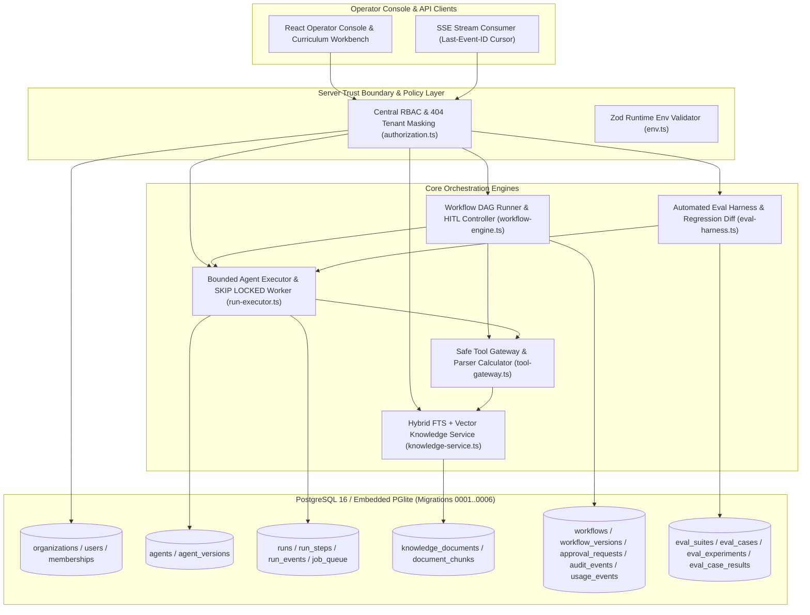

# Aegis Runtime — Multi-Tenant AI Agent & Workflow Orchestration Platform

**Aegis Runtime** is a local-first, defense-in-depth multi-tenant AI agent orchestration, Retrieval-Augmented Generation (RAG), Directed Acyclic Workflow (DAG), Human-in-the-Loop (HITL) approval, and automated evaluation platform backed by PostgreSQL and Drizzle ORM.

Built under a strict **Zero-Required-Spend (`ADR-001`)** and **Defense-in-Depth Tenant Isolation (`ADR-002`)** architecture, the entire platform—including multi-step tool execution, hybrid `tsvector` + cosine similarity RAG, `FOR UPDATE SKIP LOCKED` job queues, human approval gates, `v1`-vs-`v2` evaluation regression harnesses, and `Last-Event-ID` Server-Sent Events (SSE) replay—runs deterministically with zero external API keys required (`AI_MODE=demo`).

---

## 1. Core Architectural Pillars (9 Verified Subsystems)

1. **Multi-Tenant Foundation & Central RBAC (`TENANT-001`..`004`)**
   - Composite `(organization_id, id)` foreign keys across every domain table prevent cross-tenant orphan references at the PostgreSQL constraint layer.
   - Central policy engine (`src/server/policies/authorization.ts`) enforces a 4-role matrix (`owner`, `admin`, `developer`, `viewer`), returns `404 Not Found` (`TENANT_MISMATCH`) on cross-tenant access to prevent UUID enumeration (`ADR-002`), and enforces the last-owner safeguard (`409 Conflict`).
2. **Agent Studio & Immutable Snapshot Versioning (`AGENT-001`..`002`)**
   - Separates mutable draft configurations (`agents`) from immutable published snapshots (`agent_versions`) fingerprinted by canonical SHA-256 `snapshot_hash`. Active runs, workflows, and evaluations always pin to an immutable `agent_version_id`.
3. **Provider-Neutral AI Runtime & Citation Verification (`AGENT-003`)**
   - `MockModelProvider` (`AI_MODE=demo`) produces 100% deterministic multi-turn tool calls, embeddings, and token telemetry.
   - `verifyModelCitations()` strips any hallucinated chunk or document citations not actually returned by `knowledge_search` during the run.
4. **Bounded Agent Runtime & Safe Tool Gateway (`TOOL-001`..`002`, `RUN-001`..`002`)**
   - Recursive-descent arithmetic parser (`evaluateSafeArithmetic`) evaluates mathematical expressions with **zero `eval()` or `Function()`**.
   - `ToolGateway` enforces per-version tool allowlists (`Threat T-03`), Zod input schemas, byte-size caps, and per-call timeouts.
5. **PostgreSQL Transactional Job Queue (`QUEUE-001`..`002`, `ADR-003`)**
   - Atomic `enqueueAgentRun` inserts the `runs` record, `job_queue` row, and `run.queued` event in a single transaction.
   - Worker claiming uses `FOR UPDATE SKIP LOCKED` row leases with heartbeat expiration recovery (`recoverExpiredJobLeases`).
6. **Tenant-Isolated Knowledge Ingestion & Hybrid RAG (`RAG-001`..`003`)**
   - Sanitizes display filenames against path traversal (`Threat T-05`), generates opaque `<org_id>/<uuid>.bin` storage keys, deduplicates by SHA-256 content hash, and wraps untrusted chunks in `<untrusted_knowledge_context>` delimiters (`Threat T-03`).
   - Ranks chunks using hybrid PostgreSQL `tsvector` (`ts_rank_cd`) + 64-dimension normalized vector cosine similarity.
7. **Directed Acyclic Workflow Engine & HITL Approval Gates (`WORKFLOW-001`..`002`, `HITL-001`)**
   - 3-color DFS cycle detector (`validateWorkflowDag`) reports exact `cyclePath` diagnostics, verifies start/end reachability, and evaluates branching conditions without `eval()`.
   - Pauses runs at `approval` nodes (`waiting_approval`) and resumes or cancels upon authorized `admin`/`owner` decision (`decideApprovalRequest`).
8. **Security Audit Trail & Honest FinOps Usage Ledger (`AUDIT-001`, `USAGE-001`)**
   - Append-only `audit_events` record both `allowed` and `denied` security-sensitive operations (`Threat T-06`).
   - `usage_events` explicitly partition `mock` (`is_estimated = true`) vs `live` token consumption.
9. **Automated Evaluation Harness & SSE Replay Debugger (`EVAL-001`, `SSE-001`)**
   - Deterministic graders (`exact_match`, `contains`, `json_schema`, `citation_required`, `tool_called`) grade agent versions and compute `v1`-vs-`v2` regression diffs (`compareEvalExperiments`).
   - `createRunEventsSseResponse()` streams monotonic `run_events` and supports `Last-Event-ID` / `afterSequence` reconnect cursor replay with zero duplicate frames.

---

## 2. System Architecture & Trust Boundaries



---

## 3. Quickstart & Verification Commands

### Prerequisites
- **Node.js** `>= 20`
- **pnpm** `>= 10` (configured with `pnpm-workspace.yaml` `allowBuilds`)

### 1. Install Dependencies
```bash
pnpm install
```

### 2. Run Strict TypeScript Verification
```bash
pnpm typecheck
```

### 3. Run the Full 16-Suite Automated Test Matrix (`78/78` Tests)
Runs unit, integration, and security negative tests against embedded PostgreSQL (`@electric-sql/pglite`) with zero external services required:
```bash
pnpm test
```

### 4. Run the Deterministic Flagship Workspace Seed (`SEED-001`)
Provisions two isolated organizations (`Acme Cyber Defense` & `Beta Logistics`), ingests RAG runbooks, publishes Agent `v1` & `v2`, executes a 6-node HITL workflow with admin approval, runs `v1`-vs-`v2` evaluation regression benchmarks, and outputs a JSON verification report:
```bash
pnpm seed
```

### 5. Start the Interactive Workbench & Operator Console
```bash
pnpm dev
```
Open `http://localhost:3000` to inspect the **Live Operator Console** and the **Step-by-Step Blueprint & `.zip` Exporter**.

---

## 4. Database Migrations & Schema Map (`0001`–`0006`)

| Migration | Schema File | Tables Provisioned | Key Constraints & Indexes |
| :--- | :--- | :--- | :--- |
| `0001` | `src/server/db/schema/tenant.ts` | `organizations`, `users`, `memberships` | Composite PK `(organization_id, user_id)`, role `CHECK`, non-blank name `CHECK` |
| `0002` | `src/server/db/schema/agents.ts` | `agents`, `agent_versions` | Unique `(organization_id, slug)`, immutable `snapshot_hash` |
| `0003` | `src/server/db/schema/runs.ts` | `runs`, `run_steps`, `run_events`, `job_queue` | Monotonic `(run_id, sequence)`, `FOR UPDATE SKIP LOCKED` lease index |
| `0004` | `src/server/db/schema/knowledge.ts` | `knowledge_documents`, `document_chunks` | Composite tenant FKs, GIN `tsvector` index, SHA-256 deduplication |
| `0005` | `src/server/db/schema/workflows.ts` | `workflows`, `workflow_versions`, `approval_requests`, `audit_events`, `usage_events` | Immutable DAG `graph_json`, append-only audit & usage ledgers |
| `0006` | `src/server/db/schema/evals.ts` | `eval_suites`, `eval_cases`, `eval_experiments`, `eval_case_results` | Composite tenant FKs to `agents`, `agent_versions`, and `runs` |

---

## 5. Security Threat Model Summary (`docs/threat-model.md`)

| Threat ID | Vector | Server-Side Mitigation | Verified By |
| :--- | :--- | :--- | :--- |
| **T-01** | Cross-Tenant IDOR / Data Leakage | Composite `(organization_id, id)` FKs + `404 TENANT_MISMATCH` masking | `tests/security/tenant-isolation.test.ts`, `tests/integration/flagship-e2e.test.ts` |
| **T-02** | Privilege Escalation & Last-Owner Lockout | Central `can()` policy engine + transactional `countOwners()` check (`409`) | `tests/unit/authorization.test.ts`, `tests/security/tenant-isolation.test.ts` |
| **T-03** | Indirect Prompt Injection via RAG | `<untrusted_knowledge_context>` XML escaping + strict per-version tool allowlist | `tests/unit/rag-chunker.test.ts`, `tests/integration/knowledge-rag.test.ts` |
| **T-04** | Unbounded Agent Loop / Token Exhaustion | Hard caps on `maxSteps` (`<= 25`), `maxToolCalls`, payload bytes, and timeouts | `tests/integration/run-executor.test.ts`, `tests/unit/tool-gateway.test.ts` |
| **T-05** | Path Traversal on Document Upload | `sanitizeDisplayFilename()` + opaque `<org_id>/<uuid>.bin` storage keys | `tests/unit/rag-chunker.test.ts`, `tests/integration/knowledge-rag.test.ts` |
| **T-06** | Unauthorized HITL Approval Bypass | RBAC approval gate enforcement + append-only `denied` security `audit_events` | `tests/integration/workflow-hitl-audit.test.ts` |
| **T-07** | Secret Exposure in Health / Logs | `getPublicEnvSummary()` redacts raw keys and exposes only safe booleans | `tests/unit/env.test.ts`, `tests/unit/health-route.test.ts` |
