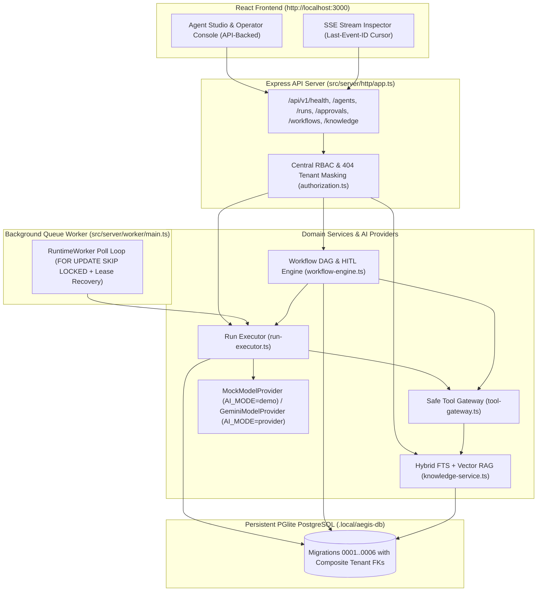

# Aegis Runtime — Multi-Tenant AI Agent & Workflow Orchestration Platform

**Aegis Runtime** is a local-first, defense-in-depth multi-tenant AI agent orchestration, Retrieval-Augmented Generation (RAG), Directed Acyclic Workflow (DAG), Human-in-the-Loop (HITL) approval, and automated evaluation platform backed by an Express HTTP API, a durable PostgreSQL job worker, and Drizzle ORM.

Built under a strict **Zero-Required-Spend (`ADR-001`)** and **Defense-in-Depth Tenant Isolation (`ADR-002`)** architecture, the entire full-stack application—including multi-step tool execution, hybrid `tsvector` + cosine similarity RAG, `FOR UPDATE SKIP LOCKED` job queues, human approval gates, `v1`-vs-`v2` evaluation regression harnesses, and `Last-Event-ID` Server-Sent Events (SSE) replay—runs deterministically out of the box with zero external API keys required (`AI_MODE=demo`).

---

## 1. Core Architectural Pillars

1. **Multi-Tenant Foundation & SQL Composite Foreign Keys (`TENANT-001`..`004`)**
   - Composite `(organization_id, ...)` foreign keys across `agent_versions`, `runs`, `run_steps`, `run_events`, `job_queue`, `document_chunks`, `workflow_versions`, `approval_requests`, `usage_events`, and `eval_experiments` prevent cross-tenant parent-child references at the PostgreSQL constraint layer.
   - Central policy engine (`src/server/policies/authorization.ts`) enforces a 4-role matrix (`owner`, `admin`, `developer`, `viewer`), returns `404 Not Found` (`TENANT_MISMATCH`) on cross-tenant access to prevent UUID enumeration (`ADR-002`), and enforces the last-owner safeguard (`409 Conflict`).

2. **Agent Studio & Immutable Snapshot Versioning (`AGENT-001`..`002`)**
   - Separates mutable draft configurations (`agents`) from immutable published snapshots (`agent_versions`) fingerprinted by canonical SHA-256 `snapshot_hash`. Active runs, workflows, and evaluations always pin to an immutable `agent_version_id`.

3. **Provider-Neutral AI Runtime & Citation Verification (`AGENT-003`)**
   - `MockModelProvider` (`AI_MODE=demo`, default) produces 100% deterministic multi-turn tool calls, embeddings, and simulated token telemetry with zero network access or API keys.
   - `GeminiModelProvider` (`src/server/ai/gemini-provider.ts`) provides an optional server-only live `@google/genai` adapter when `AI_MODE=provider`.
   - `verifyModelCitations()` strips any hallucinated chunk or document citations not actually returned by `knowledge_search` during the run.

4. **Bounded Agent Runtime & Safe Tool Gateway (`TOOL-001`..`002`, `RUN-001`..`002`)**
   - Recursive-descent arithmetic parser (`evaluateSafeArithmetic`) evaluates mathematical expressions with **zero `eval()` or `Function()`**.
   - `ToolGateway` enforces per-version tool allowlists (`Threat T-03`), Zod input schemas, byte-size caps, and per-call timeouts.

5. **PostgreSQL Transactional Job Queue & Background Worker (`QUEUE-001`..`002`, `ADR-003`)**
   - Atomic `enqueueAgentRun` inserts the `runs` record, `job_queue` row, and `run.queued` event in a single transaction.
   - `RuntimeWorker` (`src/server/worker/main.ts`) claims pending jobs via `FOR UPDATE SKIP LOCKED` row leases, recovers expired leases (`recoverExpiredJobLeases`), and handles graceful `SIGINT`/`SIGTERM` shutdown.

6. **Tenant-Isolated Knowledge Ingestion & Hybrid RAG (`RAG-001`..`003`)**
   - Sanitizes display filenames against path traversal (`Threat T-05`), generates opaque `<org_id>/<uuid>.bin` storage keys, deduplicates by SHA-256 content hash, and wraps untrusted chunks in `<untrusted_knowledge_context>` delimiters (`Threat T-03`).
   - Ranks chunks using hybrid PostgreSQL `tsvector` (`ts_rank_cd`) + 64-dimension normalized vector cosine similarity.

7. **Directed Acyclic Workflow Engine & HITL Approval Gates (`WORKFLOW-001`..`002`, `HITL-001`)**
   - 3-color DFS cycle detector (`validateWorkflowDag`) reports exact `cyclePath` diagnostics, verifies start/end reachability, and evaluates branching conditions without `eval()`.
   - Pauses runs at `approval` nodes (`waiting_approval`) and resumes or cancels upon server-authorized `admin`/`owner` decision (`POST /api/v1/approvals/:id/decision`).

8. **Security Audit Trail & Honest FinOps Usage Ledger (`AUDIT-001`, `USAGE-001`)**
   - Append-only `audit_events` record both `allowed` and `denied` security-sensitive operations (`Threat T-06`).
   - `usage_events` explicitly partition `mock` (`is_estimated = true`) vs `live` provider token consumption.

9. **Automated Evaluation Harness & SSE Replay Debugger (`EVAL-001`, `SSE-001`)**
   - Deterministic graders (`exact_match`, `contains`, `json_schema`, `citation_required`, `tool_called`) grade agent versions and compute `v1`-vs-`v2` regression diffs (`compareEvalExperiments`).
   - `GET /api/v1/runs/:id/stream` streams monotonic `run_events` and supports `Last-Event-ID` / `afterSequence` reconnect cursor replay with zero duplicate frames.

---

## 2. System Architecture & Runtime Topology



---

## 3. Quickstart & Verification Commands

### Prerequisites
- **Node.js** `>= 20` (Node 22 recommended)
- **pnpm** `>= 10`

### 1. Install Dependencies
```bash
pnpm install --frozen-lockfile
```

### 2. Run Strict TypeScript Verification
```bash
pnpm typecheck
```

### 3. Run the Automated Test Matrix (Unit, Integration & Security)
Runs all unit, PostgreSQL integration, composite FK constraint, and HTTP API/worker tests in-process:
```bash
pnpm test
```

### 4. Seed the Flagship Multi-Tenant Workspace
Provisions two isolated organizations (`Acme Cyber Defense` & `Beta Logistics`), ingests RAG runbooks, publishes Agent `v1` & `v2`, executes a 6-node HITL workflow, and runs `v1`-vs-`v2` evaluation regression benchmarks:
```bash
pnpm seed
```

### 5. Start the Full-Stack Application (Express API + Background Worker + Vite UI)
```bash
pnpm dev
```
- Open `http://localhost:3000` to use the **Agent Studio & Live Runtime Console**.
- Data persists locally on disk in `.local/aegis-db` (`PGLITE_DATA_DIR`) across server restarts.
- You can also run the standalone background worker in a separate terminal via `pnpm dev:worker`.

---

## 4. Mounted HTTP API Endpoints (`src/server/http/app.ts`)

| Method | Endpoint | Description |
| :--- | :--- | :--- |
| `GET` | `/api/v1/health/live` | Process liveness probe (`200 OK`, independent of database) |
| `GET` | `/api/v1/health/ready` | Executes a real `SELECT 1` query against PostgreSQL (`200 OK` or `503 Service Unavailable`) |
| `GET` | `/api/v1/workspace` | Returns persisted tenant state (agents, runs, approvals, workflows, docs, evals, usage, audit trail) |
| `POST` | `/api/v1/workspace/seed` | Resets and re-seeds the deterministic multi-tenant workspace |
| `GET` | `/api/v1/organizations` | Lists organizations accessible to the authenticated identity |
| `GET` | `/api/v1/agents` | Lists tenant-scoped agents |
| `POST` | `/api/v1/agents` | Creates a new draft agent |
| `PATCH` | `/api/v1/agents/:id` | Updates mutable draft agent fields without mutating published versions |
| `POST` | `/api/v1/agents/:id/publish` | Publishes an immutable `agent_versions` snapshot with SHA-256 hash |
| `POST` | `/api/v1/agents/:id/runs` | Enqueues a durable run (`202 Accepted`) and triggers worker processing |
| `GET` | `/api/v1/runs` | Lists tenant-scoped run history |
| `GET` | `/api/v1/runs/:id` | Returns run status, pinned version, step timeline, and persisted events |
| `GET` | `/api/v1/runs/:id/events` | Cursor-paginated persisted events (`?afterSequence=N`) |
| `GET` | `/api/v1/runs/:id/stream` | Server-Sent Events (`text/event-stream`) replay with `Last-Event-ID` support |
| `POST` | `/api/v1/runs/:id/cancel` | Cancels an active or queued run |
| `GET` | `/api/v1/approvals` | Lists pending and decided HITL approval gates |
| `POST` | `/api/v1/approvals/:id/decision` | Server-authorized approval/rejection; writes to `audit_events` and resumes/cancels the run |
| `GET` | `/api/v1/knowledge/documents` | Lists tenant-scoped knowledge documents |
| `POST` | `/api/v1/knowledge/documents` | Ingests, sanitizes, chunks, and indexes a knowledge document |
| `POST` | `/api/v1/workflows/:id/runs` | Starts a gated workflow DAG execution |
| `GET` | `/api/v1/usage` | Reads tenant usage ledger separating `mock` (simulated) from `live` provider tokens |
| `GET` | `/api/v1/audit-events` | Reads append-only security audit trail (`owner`/`admin` only; `403` for `viewer`/`developer`) |

---

## 5. Known Limitations & Free-Tier Trade-offs

- **Default Deterministic Model (`AI_MODE=demo`)**: Uses `MockModelProvider` by default so the entire platform, test suite, and recruiter demo run with zero API keys and zero cloud cost. Setting `AI_MODE=provider` with a server-side `GEMINI_API_KEY` enables `GeminiModelProvider`.
- **Embedded Local Persistence (`PGLITE_DATA_DIR`)**: Local development persists PostgreSQL tables on disk in `.local/aegis-db` via `@electric-sql/pglite` so no Docker daemon is required to run `pnpm dev` or `pnpm test`.
