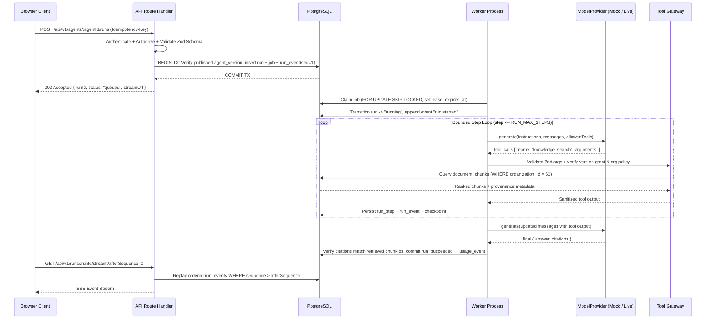

# Aegis Runtime — System Architecture (`PLAN-002`)

**Status:** Verified Baseline (Phase 0)
**Target Mode:** Local-first, Zero-Required-Spend (`AI_MODE=demo` default, optional `provider` adapter)

---

## 1. Architectural Philosophy & Core Value Proposition

Most portfolio AI projects are thin wrappers around a chat completion endpoint: the browser sends a prompt, an HTTP handler waits on an external LLM, and the response streams back with no durability, no tenant isolation, and no server-enforced tool boundaries.

**Aegis Runtime** is architected around **observable, bounded, and multi-tenant execution**:

1. **Strict Multi-Tenant Isolation**: Every domain record (`agents`, `agent_versions`, `runs`, `jobs`, `documents`, `workflows`) is owned by an `organization_id` and enforced by both composite SQL foreign keys and a central server-side policy engine (`can(actor, action, resourceContext)`).
2. **Immutable Execution Snapshots**: Runs never execute against an editable draft. Publishing an agent or workflow creates an immutable snapshot (`agent_versions` / `workflow_versions`) with a SHA-256 content hash.
3. **Transactional Run + Queue Enqueue**: Accepting a run (`POST /api/v1/agents/:agentId/runs`) inserts the `runs` record, the `jobs` queue record, and sequence `1` (`run.queued`) in `run_events` inside a **single PostgreSQL transaction**—eliminating dual-write inconsistencies between the database and the job queue.
4. **Separate Worker Boundary with Row Leases**: Long-running agent loops never block HTTP route handlers. A dedicated Node.js worker claims jobs from PostgreSQL using `FOR UPDATE SKIP LOCKED` with time-bounded leases, heartbeats, and expired-lease recovery.
5. **Deterministic Mock-First AI**: The runtime depends on a provider-neutral `ModelProvider` contract. By default (`AI_MODE=demo`), `MockModelProvider` executes deterministic multi-step tool and citation scenarios with zero network calls and zero API cost.

---

## 2. Logical System Architecture

```mermaid
flowchart TB
  B[Browser / App Router UI] --> API[API Route Handlers /api/v1/*]
  API --> AUTH[Authentication + Central Policy can()]
  API --> APP[Domain Services]
  APP --> DB[(PostgreSQL / Drizzle ORM)]
  APP --> FILES[Local Opaque File Store]
  DB --> JOBS[PostgreSQL Job Queue]
  JOBS --> WORKER[Node.js Worker Process]
  WORKER --> RUNTIME[Bounded Agent Runtime]
  RUNTIME --> MOCK[Deterministic MockModelProvider]
  RUNTIME -. optional .-> LLM[Configured Live Provider Adapter]
  RUNTIME --> TOOLS[Tool Registry + Server Policy Gateway]
  TOOLS --> SEARCH[PostgreSQL Full-Text Search tsvector]
  WORKER --> EVENTS[Append-Only Run Events]
  EVENTS --> API
  API --> STREAM[SSE Replay + Live Stream]
```

---

## 3. Layer Responsibilities & Dependency Direction

To prevent spaghetti code and security bypasses, dependencies flow strictly inward from delivery layers to domain and persistence layers:

| Layer | Directory / Location | Allowed Responsibilities | Strictly Forbidden |
|---|---|---|---|
| **Presentation & Views** | `src/app/*`, `src/components/*`, `src/features/*` | Render state, validate forms for UX feedback, subscribe to SSE streams, invoke `/api/v1/*` endpoints. | Importing `src/server/*` database clients, trusting UI role flags for security, or holding provider secrets. |
| **API Route Handlers** | `src/app/api/v1/*` | Parse HTTP requests, validate payloads with Zod, resolve trusted session/organization context, call domain services, return standard JSON / Problem Details envelopes. | Running multi-step agent loops inline, writing raw SQL queries, or leaking stack traces. |
| **Central Policy Engine** | `src/server/policies/*` | Evaluate `can(actor, action, resourceContext)` across roles (`owner`, `admin`, `developer`, `viewer`) and enforce last-owner safeguards. | Relying on client-passed `organizationId` without verifying membership. |
| **Domain Services** | `src/server/modules/*` | Enforce state transitions, immutable version hashing, idempotency key hashing, and transactional boundaries. | Calling specific LLM vendor SDKs directly. |
| **AI Runtime & Tool Gateway** | `src/server/ai/*`, `src/server/modules/tools/*` | Run the bounded step loop, enforce `maxSteps`/`maxToolCalls`/`timeoutSeconds`, validate tool arguments with Zod, intersect version tool grants with org policy. | Executing `eval()`, shell commands, or arbitrary user-supplied URLs. |
| **Repositories & Persistence** | `src/server/db/*` | Execute tenant-scoped Drizzle/SQL queries where `organizationId` is a required argument on every tenant resource query. | Exposing unscoped `findById(id)` methods on tenant-owned tables. |
| **Background Worker** | `src/worker/*` | Poll due jobs with `FOR UPDATE SKIP LOCKED`, maintain lease heartbeats, invoke the runtime, and recover expired leases. | Importing React/client code or holding open DB transactions during model/tool calls. |

---

## 4. End-to-End Run Lifecycle & State Sequence



---

## 5. Run State Machine & Allowed Transitions

Every run follows a strict, server-enforced state machine:

```text
[queued] ──────────────────────► [running] ──────────────────────► [succeeded] (Terminal)
   │                                │  │
   │                                │  ├─────────────────────────► [failed]    (Terminal)
   │                                │  │
   │                                │  ▼
   │                                │ [waiting_approval] / [waiting]
   │                                │  │
   ▼                                ▼  ▼
[cancel_requested] ───────────► [cancelled] (Terminal)
```

- **Important Invariant**: Never hold a PostgreSQL transaction open while awaiting a model response or tool execution. Claim the lease in a short transaction, execute the step, and open a short transaction to record the step result, increment `last_event_sequence`, and update the checkpoint.

---

## 6. Runtime Guardrails & Default Budgets

All execution limits are validated at startup via Zod and enforced server-side:

- `RUN_MAX_STEPS`: `8` steps maximum per run.
- `RUN_MAX_TOOL_CALLS`: `6` tool calls maximum per run.
- `RUN_TIMEOUT_SECONDS`: `120` seconds maximum wall-clock duration.
- `MAX_UPLOAD_BYTES`: `10,485,760` bytes (`10 MiB`) per document in local development.
- `WORKER_CONCURRENCY`: `2` concurrent jobs per worker process by default.
- `AI_MODE`: `demo` by default (deterministic, zero external network calls, zero cost).

