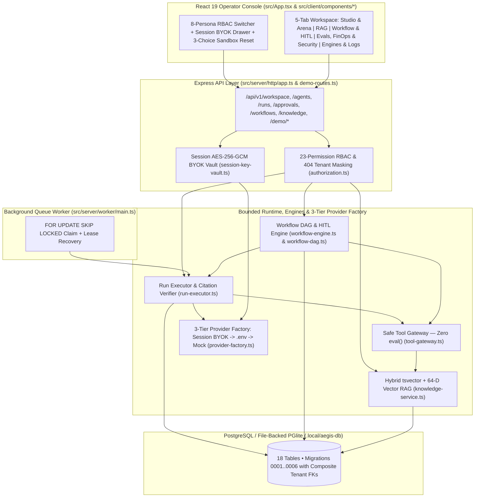
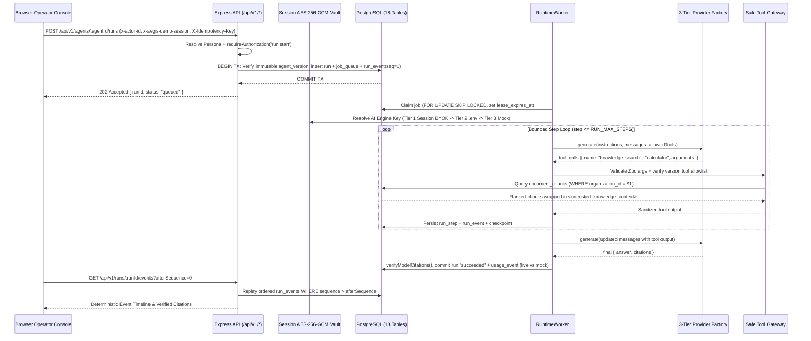

# Aegis Runtime (`v1.0.0-demo`) — System Architecture (`PLAN-002`)

**Status:** Verified Release (`v1.0.0-demo` — Phases `A`–`I` / Checkpoints `1`–`12` Complete)
**Target Mode:** Local-first, Zero-Required-Spend (`AI_MODE=demo` default) with 3-Tier Live Cloud AI Resolution (`Session AES-256-GCM BYOK Vault -> Server .env -> Deterministic Mock`)

---

## 1. Architectural Philosophy & Core Value Proposition

Most portfolio AI projects are thin wrappers around a chat completion endpoint: the browser sends a prompt, an HTTP handler waits on an external LLM, and the response streams back with no durability, no tenant isolation, and no server-enforced tool boundaries.

**Aegis Runtime (`v1.0.0-demo`)** is architected around **observable, bounded, and multi-tenant execution**:

1. **Strict Multi-Tenant Isolation & 8-Persona RBAC**: Every domain record (`agents`, `agent_versions`, `runs`, `job_queue`, `knowledge_documents`, `workflows`, `approval_requests`, `usage_events`, `eval_experiments`) is owned by an `organization_id` and enforced by both composite PostgreSQL foreign keys and a central server-side 23-permission policy engine (`src/server/policies/authorization.ts`). Cross-tenant lookups always return `404 Not Found` (`TENANT_MISMATCH`) to prevent UUID existence enumeration (`ADR-002`).
2. **Immutable Execution Snapshots**: Runs never execute against an editable draft. Publishing an agent or workflow creates an immutable snapshot (`agent_versions` / `workflow_versions`) fingerprinted by a canonical SHA-256 `snapshot_hash`.
3. **3-Tier AI Provider Resolution & Session-Scoped AES-256-GCM BYOK Vault**:
   - **Tier 1 (Session BYOK Vault)**: Visitor-supplied cloud API keys (`Gemini`, `ChatGPT`, `Claude`, `Grok`, `OpenRouter`) are encrypted in server RAM using `aes-256-gcm` (`src/server/security/session-key-vault.ts`) under an ephemeral 256-bit CSPRNG master key scoped to `x-aegis-demo-session` with a 2-hour sliding TTL.
   - **Tier 2 (Server `.env`)**: Optional environment-level free-tier keys.
   - **Tier 3 (Deterministic Simulation Engine)**: Zero-key, zero-spend `MockModelProvider` fallback (`ADR-001`).
4. **Transactional Run + Queue Enqueue**: Accepting a run (`POST /api/v1/agents/:agentId/runs`) inserts the `runs` record, the `job_queue` row, and sequence `1` (`run.queued`) in `run_events` inside a **single PostgreSQL ACID transaction**—eliminating dual-write inconsistencies between the database and the job queue.
5. **Separate Worker Boundary with Row Leases**: Long-running agent loops never block HTTP route handlers. `RuntimeWorker` (`src/server/worker/main.ts`) claims jobs from PostgreSQL using `FOR UPDATE SKIP LOCKED` with time-bounded leases, heartbeats, and expired-lease recovery (`ADR-003`).

---

## 2. Logical System Architecture (`v1.0.0-demo`)



---

## 3. Layer Responsibilities & Dependency Direction

To prevent architectural drift and security bypasses, dependencies flow strictly inward from delivery layers to domain and persistence layers:

| Layer | Directory / Location | Allowed Responsibilities | Strictly Forbidden |
|---|---|---|---|
| **Presentation & Operator Console** | `src/App.tsx`, `src/client/components/*` | Render 5-tab workspace, manage active persona (`x-actor-id`) and session token (`x-aegis-demo-session`), subscribe to SSE streams, invoke `/api/v1/*` endpoints. | Importing `src/server/*` database clients, trusting UI role flags for security, or holding raw provider secrets after submission. |
| **HTTP API & Demo Governance Routes** | `src/server/http/app.ts`, `src/server/http/demo-routes.ts` | Parse HTTP requests, validate payloads with Zod, resolve persona/tenant context, manage Session BYOK Vault entries, return RFC 9457 Problem Details on error. | Running unbounded loops, bypassing `authorize()`, or returning raw API keys or stack traces. |
| **Central Policy Engine** | `src/server/policies/authorization.ts` | Evaluate `authorize(actor, action, resourceContext)` across 23 permissions and 4 roles (`owner`, `admin`, `developer`, `viewer`), enforce `404` cross-tenant masking and `409` last-owner protection. | Relying on client-passed `organizationId` without verifying membership. |
| **Session Security Vault** | `src/server/security/session-key-vault.ts` | Encrypt/decrypt session-scoped BYOK keys in memory with `aes-256-gcm`, enforce 2-hour TTL, emit masked key previews. | Writing raw API keys to disk, database tables, or logs. |
| **AI Runtime, Arena & Tool Gateway** | `src/server/ai/*`, `src/server/runtime/*`, `src/server/tools/*` | Resolve 3-tier AI providers, run the bounded step loop, enforce `maxSteps`/`maxToolCalls`/`timeoutSeconds`, validate tool arguments with Zod, strip hallucinated citations. | Executing `eval()`, `Function()`, shell commands, or arbitrary user-supplied URLs. |
| **Workflows, RAG & Evaluations** | `src/server/workflows/*`, `src/server/knowledge/*`, `src/server/evals/*` | Validate DAG cycles with 3-color DFS, pause/resume HITL approval gates, chunk and rank RAG documents with `<untrusted_knowledge_context>`, run `v1`-vs-`v2` regression graders. | Trusting model-supplied `organizationId` in `knowledge_search`. |
| **Persistence & Background Worker** | `src/server/db/*`, `src/server/worker/*` | Execute tenant-scoped Drizzle/SQL queries, poll due jobs with `FOR UPDATE SKIP LOCKED`, maintain lease heartbeats, and recover expired leases. | Holding open DB transactions while awaiting external model or tool calls. |

---

## 4. End-to-End Run Lifecycle & 3-Tier AI Resolution Sequence



---

## 5. Run State Machine & Allowed Transitions

Every run follows a strict, server-enforced state machine:

```text
[queued] ──────────────────────► [running] ──────────────────────► [succeeded] (Terminal)
   │                                │  │
   │                                │  ├─────────────────────────► [failed]    (Terminal)
   │                                │  │
   │                                │  ▼
   │                                │ [waiting_approval] (HITL Gate Paused)
   │                                │  │ (owner/admin decision: approve -> running, reject -> cancelled)
   ▼                                ▼  ▼
[cancel_requested] ───────────► [cancelled] (Terminal)
```

---

## 6. Runtime Guardrails & Default Budgets

All execution limits are validated at startup via Zod (`src/server/config/env.ts`) and enforced server-side:

- `RUN_MAX_STEPS`: `8` steps maximum per run.
- `RUN_MAX_TOOL_CALLS`: `6` tool calls maximum per run.
- `RUN_TIMEOUT_SECONDS`: `120` seconds maximum wall-clock duration.
- `MAX_UPLOAD_BYTES`: `10,485,760` bytes (`10 MiB`) per document.
- `WORKER_CONCURRENCY`: `2` concurrent jobs per worker process by default.
- `BYOK_SESSION_TTL_MS`: `7,200,000` ms (`2 hours`) sliding in-memory session key expiration.

---

## 7. Planned Architectural Evolution (`v1.1` – `v2.0`)

1. **`v1.1` — Production Auth & KMS Envelope Encryption**:
   - Add OAuth 2.0 / OIDC session authentication alongside demo persona switching (`DEMO_MODE=false`), plus KMS-wrapped persistent tenant API keys (`tenant_api_keys`) and scoped machine-to-machine API tokens.
2. **`v1.2` — Native `pgvector` HNSW & Async Multimodal Ingestion**:
   - Add `pgvector` HNSW indexing for external PostgreSQL deployments while retaining the zero-dependency hybrid scorer for local PGlite, and move large PDF/CSV chunking onto background worker jobs.
3. **`v1.3` — OpenTelemetry (OTLP) Tracing & Signed Outbound Webhooks**:
   - Propagate W3C trace context across HTTP -> PostgreSQL queue -> worker -> LLM provider calls and deliver `HMAC-SHA256` signed webhooks for HITL approvals and run completions.
4. **`v2.0` — Multi-Agent Delegation Graphs & Hard FinOps Spend Quotas**:
   - Support bounded parent-to-child sub-agent delegation (`MAX_DELEGATION_DEPTH = 3`), organization token/USD budget enforcement, and WebAssembly-sandboxed custom tool plugins.
